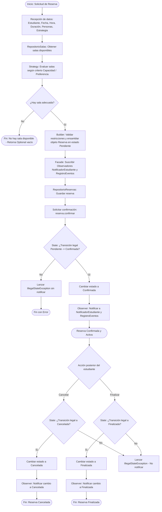

# Diagrama de Flujo del Proceso de Reserva de Biblioteca

## Descripción del Flujo
El proceso modela el ciclo de vida completo de una solicitud de reserva en la biblioteca «Espacio de Estudio», integrando los patrones de diseño requeridos:
1. **Entrada de datos**: Se reciben los datos de la solicitud (Estudiante, Fecha, Hora, Duración, Cantidad de Personas y Estrategia).
2. **Consulta de disponibilidad**: La fachada consulta el catálogo de salas disponibles en el repositorio.
3. **Selección por Estrategia (Strategy)**: Se delega el algoritmo de selección a la estrategia configurada (`SeleccionPorCapacidad` o `SeleccionSalaPreferida`).
4. **Decisión clave («¿Hay sala adecuada?»)**:
   - **NO**: El flujo finaliza inmediatamente retornando un `Optional.empty()` e informando que no existe sala disponible que cumpla los criterios. No se genera ninguna reserva ni se notifica.
   - **SÍ**: Se continúa con la construcción y ciclo de vida.
5. **Construcción y Validación (Builder)**: `ReservaBuilder` valida la integridad de los datos (no nulos, fecha presente o futura, duración > 0, personas > 0, capacidad de sala suficiente) y genera el identificador único (`R-XXXXXXXX`).
6. **Coordinación y Registro (Facade)**: La fachada guarda la reserva en el repositorio y suscribe los observadores.
7. **Control de Estado (State)**: La reserva inicia en `Pendiente`. Al solicitar `confirmar()`, el estado valida la transición legal a `Confirmada`. Si una transición no está permitida, se lanza `IllegalStateException` y se aborta sin cambio de estado.
8. **Notificación de Eventos (Observer)**: Cada cambio de estado efectivo dispara el método `actualizar` de todos los observadores registrados (`NotificadorEstudiante`, `RegistroEventos`). Transiciones fallidas no disparan notificación.
9. **Ciclo posterior de la reserva**: Una reserva confirmada puede pasar a `Cancelada` o `Finalizada` validada por sus respectivos estados.

## Diagrama de Flujo (Mermaid)

