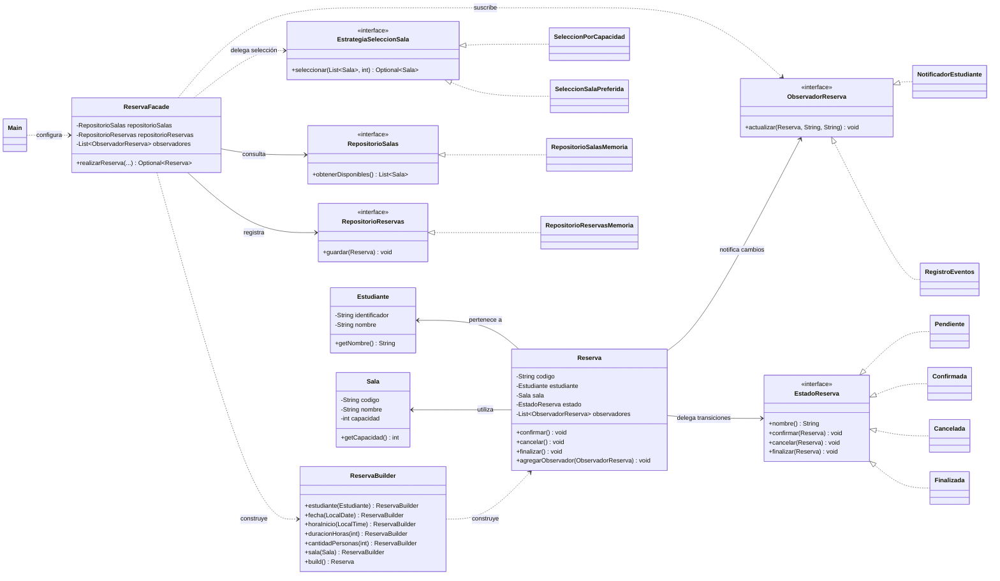

# Estación 8 — Diagrama de clases del sistema de reservas

El siguiente diagrama representa las **21 clases e interfaces de producción** implementadas en el paquete `biblioteca`. Se organizan las responsabilidades por dominios y patrones para facilitar su lectura. La clase `Main` solo crea dependencias e invoca a la fachada.

## Relaciones y cardinalidades principales

- Cada `Reserva` contiene un `Estudiante` y una `Sala`; una misma sala puede estar referenciada por múltiples reservas porque la disponibilidad es simulada.
- Cada `Reserva` tiene exactamente un estado activo, que implementa `EstadoReserva`.
- Cada `Reserva` mantiene cero o más observadores; en el flujo principal se registran dos.
- `ReservaFacade` se construye con un repositorio de salas, un repositorio de reservas y una lista de observadores; la estrategia se selecciona por llamada.
- El dominio de la práctica no incluye persistencia, base de datos ni prevención de horarios solapados.
